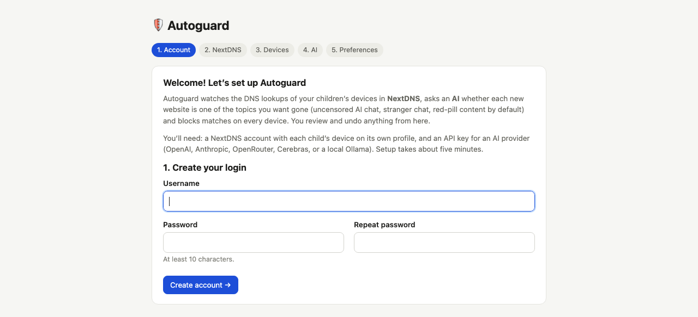
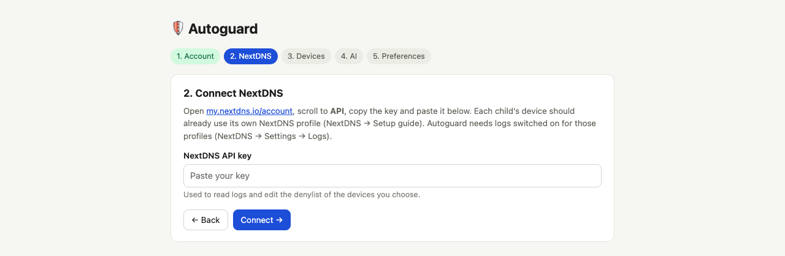
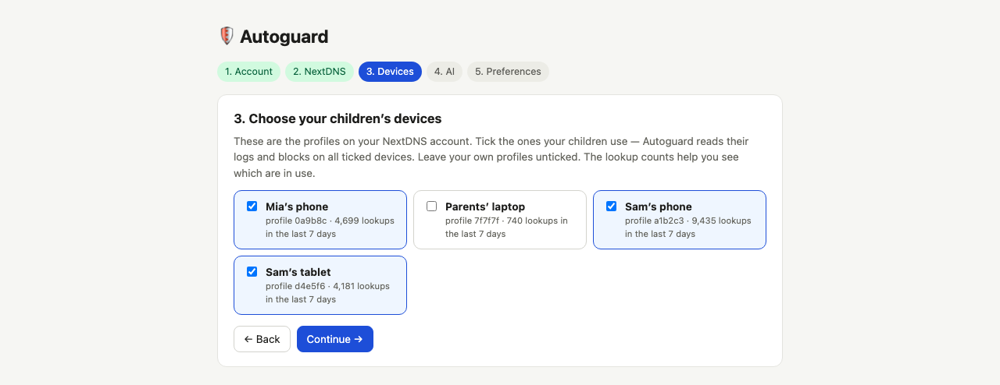
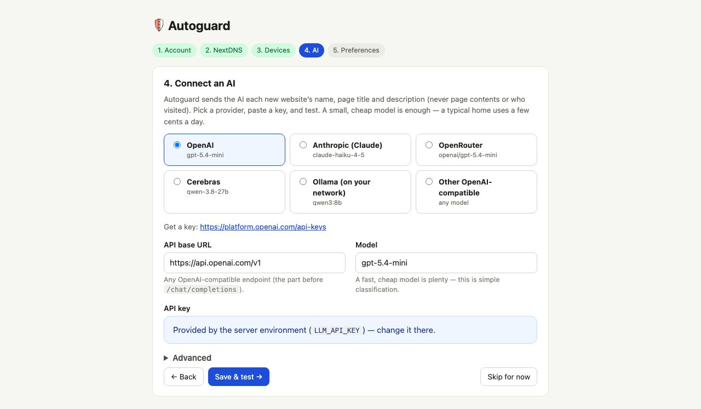
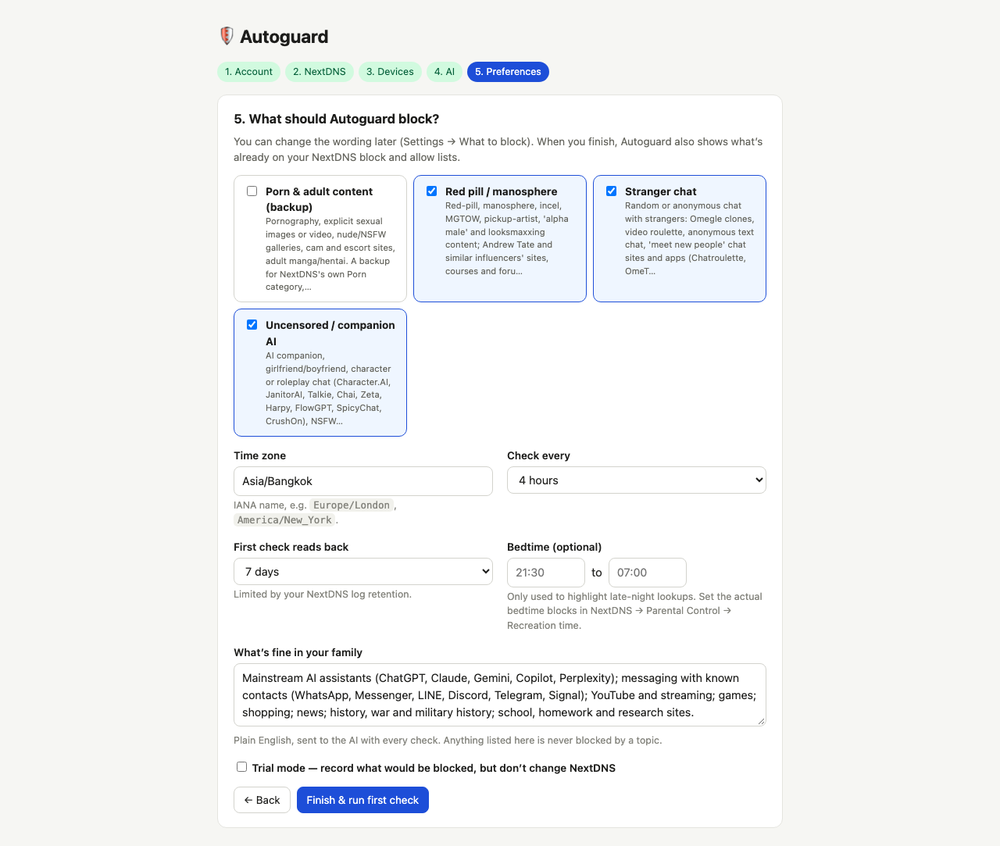

# 3. First-time setup

[← Installing Autoguard](02-install.md) · Next: [Everyday use →](04-everyday-use.md)

Open `http://<computer's address>:8095`. A fresh install always starts here. Setup has five steps and takes about
five minutes. You can go back to an earlier step with **← Back**; nothing is final until you press **Finish**.

## Step 1: create your login

Choose a username and a password of at least 10 characters. This account can change everything, so use a proper
password. You can add the other parent later under **Settings → People**.

## Step 2: connect NextDNS

Paste the API key from [my.nextdns.io/account](https://my.nextdns.io/account) (the **API** section at the bottom)
and press **Connect**. Autoguard checks it straight away. If the key is wrong you'll see
*"NextDNS didn't accept that"*; copy it again and make sure nothing is missing at either end.

Autoguard uses this key to read the logs of the devices you choose in the next step, and to add or remove sites on
those devices' NextDNS block lists. It doesn't change anything else in your account.

## Step 3: choose your children's devices

Every profile in your NextDNS account is listed with the number of lookups it made in the last 7 days. Tick your
children's devices. **Leave your own profiles unticked**: Autoguard never reads or changes an unticked profile.

A device showing very few lookups probably isn't using NextDNS properly yet; see
[Before you start](01-before-you-start.md#step-2-put-each-device-on-its-profile).

## Step 4: connect an AI

1. Pick your provider. The address and a sensible small model are filled in for you, and a link shows where to get
   a key.
2. Paste your AI key.
3. Press **Save & test**. Autoguard sends three made-up example sites to the AI (a stranger-chat site, an
   encyclopedia and an AI-girlfriend site) and checks the answers. If it works you move on; if not, you'll see the
   provider's own error message, for example *"HTTP 401: invalid key"*.

The AI only ever receives a site's address, its page title and short description, your topic descriptions and
your "what's fine" note. It never learns which child visited what, or when.

**Skip for now** is there if you don't have a key yet. Autoguard will then collect sites but not block anything new
until you add one under **Settings → Connections**.

Using Ollama on your own computer? Pick *Ollama (on your network)*; no key is needed. Using another service?
Pick *Other OpenAI-compatible* and enter its address and model name.

## Step 5: preferences

- **What to block.** The default topics are *Uncensored / companion AI*, *Stranger chat* and *Red pill /
  manosphere*. There's also an optional *Porn & adult content (backup)* topic, off by default, which catches adult
  sites NextDNS's own Porn category hasn't listed yet. You can reword or add topics later.
- **Time zone.** Filled in from your browser. Times in Autoguard use it.
- **Check every.** Every 4 hours suits most families. "Never" means you press **Check now** yourself.
- **First check reads back.** How many days of history the first check looks at. 7 days is a good start.
- **Bedtime (optional).** Only used to highlight lookups made at night. Real bedtime blocking is set in NextDNS
  (Parental Control → Recreation time).
- **What's fine in your family.** Plain English, sent to the AI with every question. For example: *"History and
  military sites, Minecraft, chess, ChatGPT for homework, WhatsApp with friends."* Anything you list here won't be
  blocked by a topic.
- **Trial mode.** Tick it if you'd like to watch what Autoguard *would* block for a few days before letting it act.
  A yellow banner reminds you it's on.

Press **Finish & run first check**.

## What happens next

The first check starts immediately and the Home page updates by itself while it runs. It:

1. Copies what's already on each device's NextDNS **block list** onto the Blocked page, and your NextDNS
   **allow list** onto Fine sites.
2. Reads the chosen number of days of lookups from every ticked device.
3. Looks at each new site's homepage and asks the AI about it.
4. Blocks clear matches on all ticked devices and puts unsure ones in **To check**.

For a busy family and 7 days of history this takes a few minutes. After that Autoguard checks by itself on the
schedule you chose.

[Next: Everyday use →](04-everyday-use.md)
