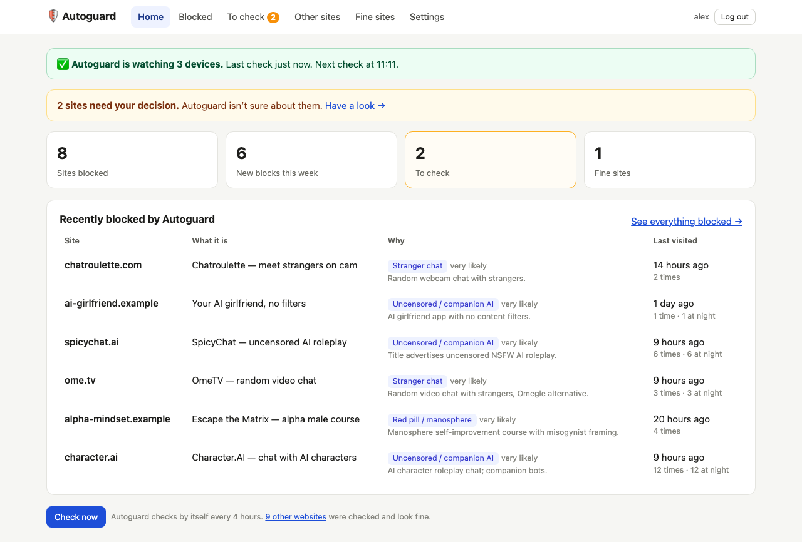
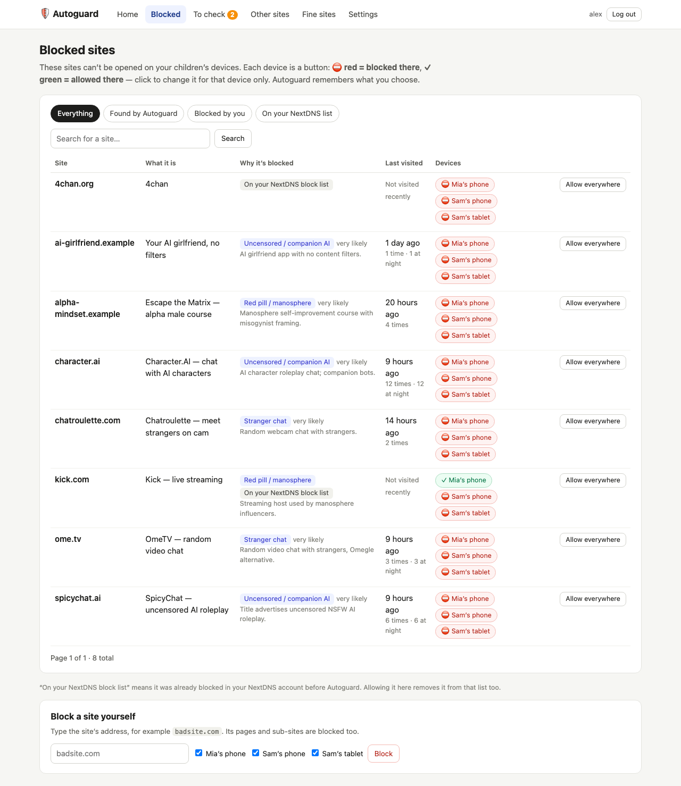
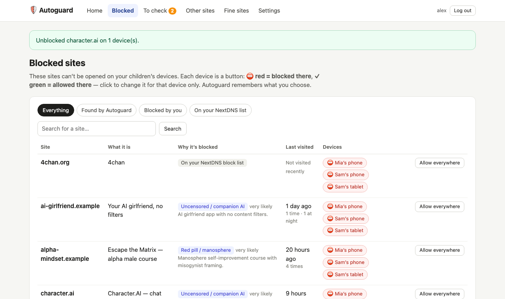
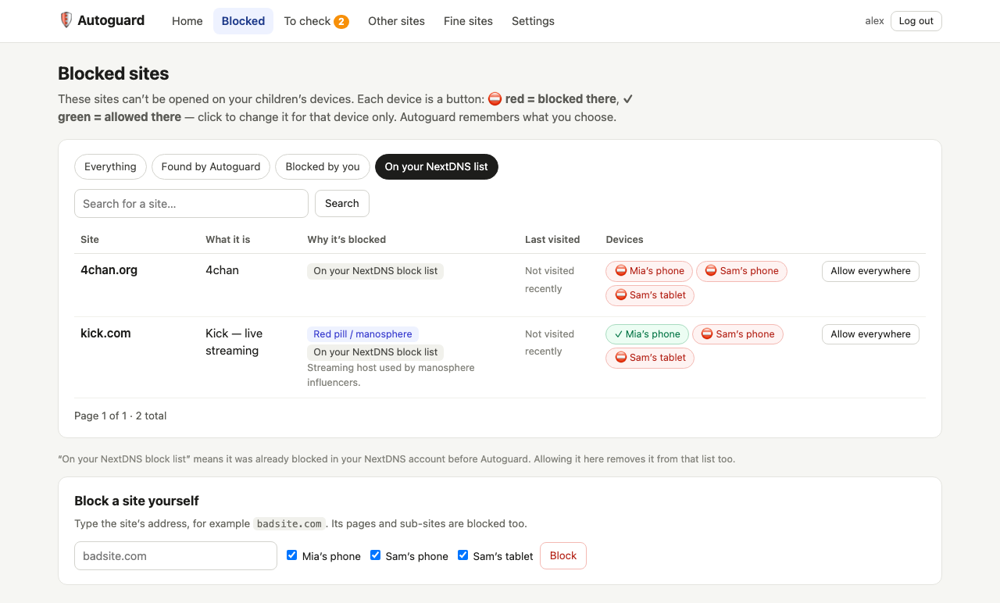
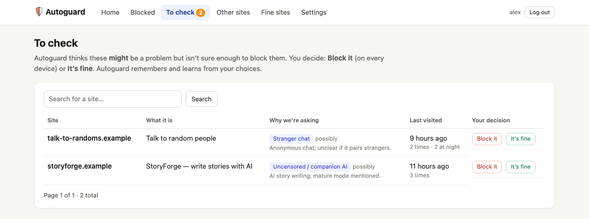
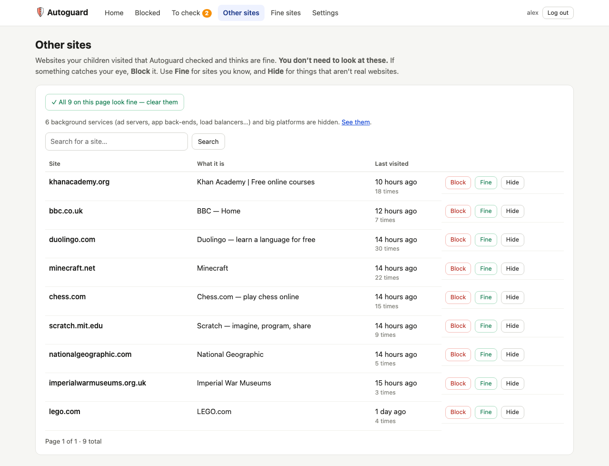
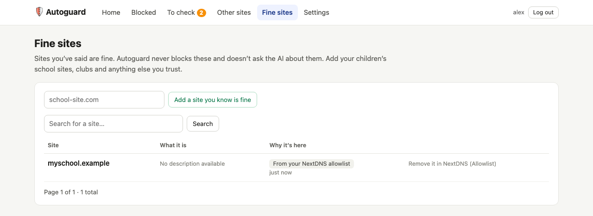

# 4. Everyday use

[← First-time setup](03-first-time-setup.md) · Next: [Settings →](05-settings.md)

Autoguard is built so you only look at what might be a problem. In practice: open **Home** now and then, deal with
anything in **To check**, and leave the rest.

The menu along the top: **Home · Blocked · To check · Other sites · Fine sites · Settings**. When something needs
your decision, **To check** shows an orange number.

## Home

- **The green bar** says how many devices are watched, when the last check ran and when the next one is due. If
  the last check had a problem the bar turns red and explains it. Sites already blocked stay blocked either way.
- **The yellow bar** appears when sites need your decision, with a link to them.
- **The four boxes**: sites blocked, new blocks this week, sites to check, and your fine sites. Each is a link.
- **Recently blocked by Autoguard** lists the newest automatic blocks: the site, what it is (its page title), why
  it was blocked and when it was last visited.
- **Check now** runs a check straight away instead of waiting for the schedule.

## Blocked

Every site that can't be opened on your children's devices, newest first, 50 per page.

- **Filters** across the top: *Everything*, *Found by Autoguard*, *Blocked by you*, and *On your NextDNS list*
  (sites that were already on your NextDNS block lists).
- **Search** finds a site by name.
- **Why it's blocked** shows the topic and how sure the AI was (*possibly*, *likely*, *very likely*) with its
  one-line reason.
- **Last visited** shows when, how many times, and how many of those were at night (if you set a bedtime).
- **Devices**: one button per device. **⛔ red** means blocked on that device; **✓ green** means allowed there.
  Click a button to change just that device.
- **Allow everywhere** unblocks the site on every device and puts it on your Fine sites, so it's never blocked
  again.

Autoguard remembers every choice. If you allow a site on Sam's tablet only, later checks won't block it there again.

**Sites from your NextDNS list.** Autoguard shows what was already on your NextDNS block lists so you can see
everything in one place. If you change those lists in NextDNS directly, Autoguard follows. Allowing one of them
here also removes it from NextDNS.

### Block a site yourself

At the bottom of the Blocked page, type a site's address (for example `badsite.com`; pasting a full link like
`https://www.badsite.com/page` works too), tick the devices and press **Block**. The whole site and its sub-sites
are blocked.

## To check

Sites the AI thinks *might* match one of your topics but isn't sure enough to block automatically. For each one:

- **Block it** blocks it on every device.
- **It's fine** moves it to Fine sites; it won't be asked about again.

Your answers are shown to the AI as examples in later checks, so it gradually learns where your family draws the
line. A site marked *"Will be blocked at the next check unless you say it's fine"* was a clear match held back by
the per-check limit (see [Settings → Blocking rules](05-settings.md#blocking-rules)).

## Other sites

Real websites your children visited that the AI judged fine. **You don't need to read this page.** It's there if
you're curious or want to double-check. Per site:

- **Block** blocks it on every device.
- **Fine** moves it to Fine sites.
- **Hide** hides it for good. Use this for things that aren't real websites.

**✓ All on this page look fine — clear them** moves the whole page to Fine sites in one click.

Ad servers, app back-ends, load balancers and similar background services don't appear here. Autoguard sorts them
out automatically (anything without a homepage you could open counts as one); you'll find them under
**Settings → Hidden sites**.

## Fine sites

Sites you trust. Autoguard never blocks them and doesn't send them to the AI.

- Add sites before they ever come up, such as school portals, clubs and homework sites, with **Add a site you
  know is fine**.
- **Remove** takes a site off the list; Autoguard will check it again next time it's visited.
- Sites marked *From your NextDNS allowlist* come from NextDNS. To remove those, edit the Allowlist in NextDNS.

[Next: Settings →](05-settings.md)
