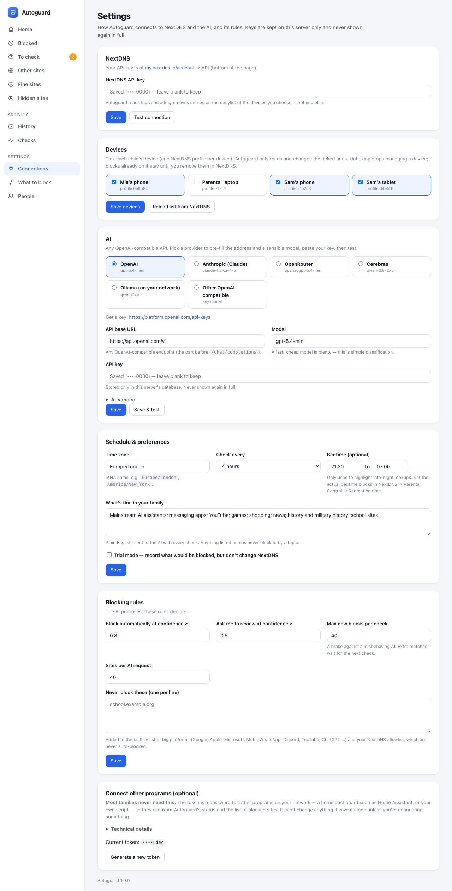
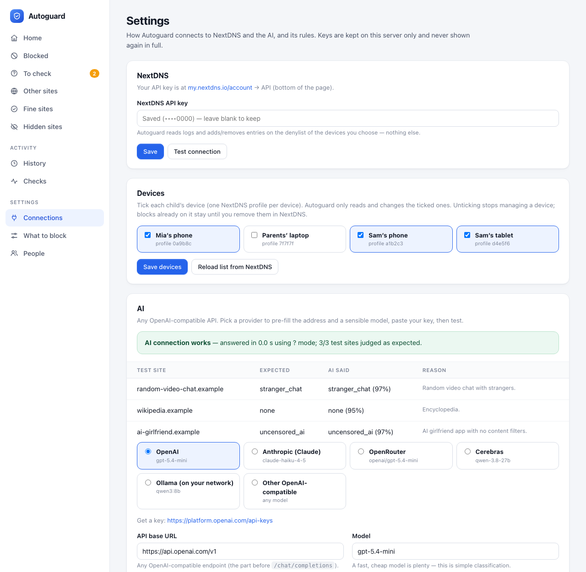
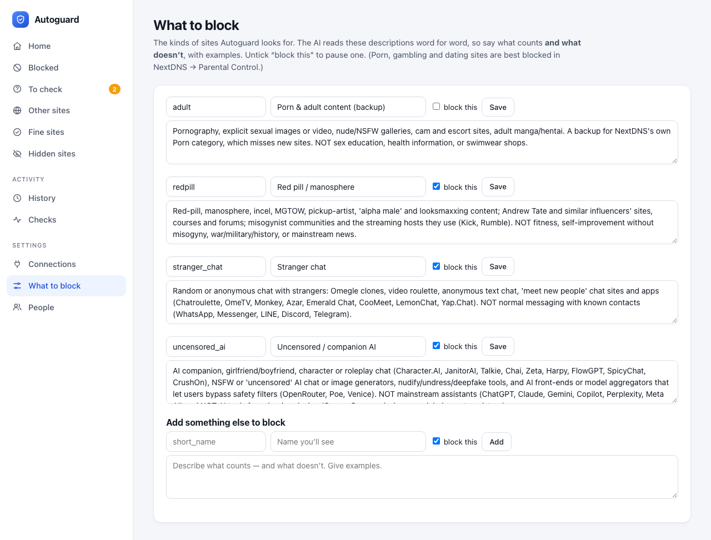
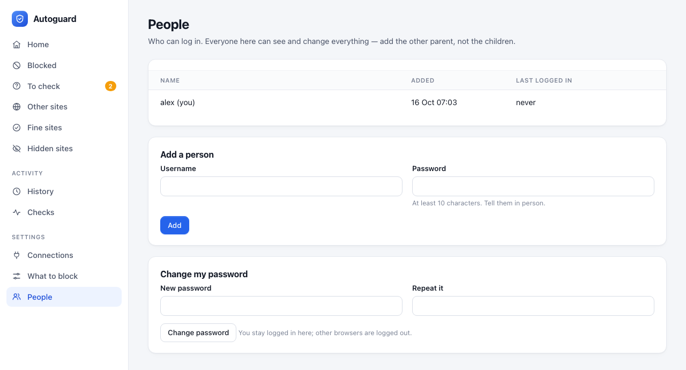
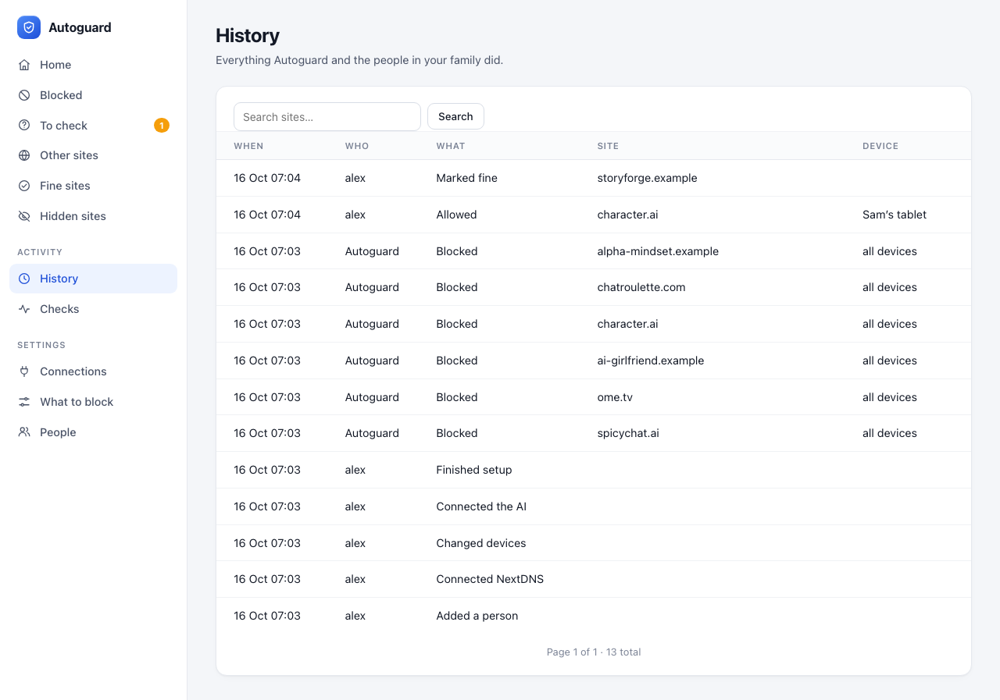
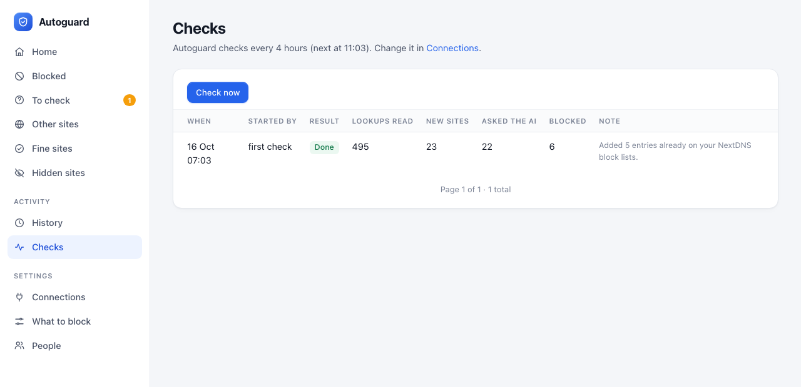

# 5. Settings

[← Everyday use](04-everyday-use.md) · Next: [Looking after it →](06-looking-after-it.md)

In the left-hand menu, **Settings** has **Connections · What to block · People**, and **Activity** has
**History · Checks**. (Hidden sites moved to the main menu — see [Everyday use](04-everyday-use.md#hidden-sites).)

## Connections

### NextDNS

Paste a new key to replace the saved one, or leave the box empty to keep it. **Test connection** confirms the key
works and says how many profiles your account has. Saved keys only ever show their last four characters.

### Devices

Tick or untick devices, then **Save devices**. **Reload list from NextDNS** picks up profiles you created since
setup.

- A newly ticked device gets every site Autoguard has blocked so far, at the next check.
- Unticking a device stops Autoguard reading or changing it. Blocks already on it stay in NextDNS until you remove
  them there.

### AI

The same choices as in setup. **Save & test** runs the three example sites again and shows what the AI answered:

Under **Advanced**:

- **JSON mode** controls how Autoguard asks for a structured answer. *Auto-detect* tries the strictest method first
  and falls back if the provider refuses. Anthropic's endpoint needs *Prompt only*; the preset sets it for you.
- **Extra request fields** are sent with every AI request, for example `{"reasoning_effort": "low"}` for models
  that "think" before answering.

### Schedule & preferences

Time zone, how often to check, bedtime highlighting, your "what's fine in our family" note, and **trial mode**.
While trial mode is on, Autoguard records what it *would* block and shows a yellow banner, but changes nothing in
NextDNS.

### Blocking rules

The AI suggests; these rules decide.

| Setting | Default | What it means |
|---|---|---|
| Block automatically at confidence ≥ | 0.8 | How sure the AI must be (0 to 1) before a site is blocked without asking you. |
| Ask me to review at confidence ≥ | 0.5 | Between this and the block level, a site goes to **To check**. |
| Max new blocks per check | 40 | A brake against a misbehaving AI. Extra matches wait for the next check. |
| Sites per AI request | 40 | Lower it if your AI provider struggles with long requests. |
| Never block these | empty | One site per line. Added to the built-in list below. |

Some sites are **never** blocked automatically, whatever the AI says: big platforms and the services phones need
to work (Google, Apple, Microsoft, Meta and WhatsApp, Discord, YouTube, ChatGPT, Claude and others), plus
everything on your NextDNS allowlist and your Fine sites. If you want one of those platforms gone, use NextDNS's
Parental Control → Apps, or block it yourself on the Blocked page.

### Connect other programs (optional)

**Most families never need this.** The token is a password for other programs on your network, such as a home
dashboard like Home Assistant or your own script. With it they can **read** Autoguard's status and the list of
blocked sites per device; they can't change anything. If you're not connecting anything, ignore it.

Technical details: `GET /api/status.json` and `GET /api/denylist.json` with the header
`Authorization: Bearer <token>`. **Generate a new token** replaces the old one, which stops working immediately.
The new token is shown once.

## What to block

Each topic has a short name, a label you'll see in the dashboard, a description and a **block this** tick box.

The description is sent to the AI word for word, so it matters. Good descriptions:

- name typical examples (*"Omegle copies, Chatroulette, OmeTV"*);
- say clearly what **doesn't** count (*"NOT normal messaging with friends: WhatsApp, Messenger"*);
- use plain words, not jargon.

If something slips through, add it as an example. If a harmless site keeps landing in To check, add it to the
"NOT" part. Untick **block this** to pause a topic without losing its wording. Use **Add something else to block**
for a new topic, for example gambling-style game shops or a particular kind of forum.

Porn, gambling and dating are best blocked by NextDNS's own Parental Control categories; the optional *Porn &
adult content (backup)* topic only catches what those miss.

## People

Add the other parent with a username and a password of at least 10 characters. Everyone listed can see and change
everything, so don't add the children. **Change my password** keeps you logged in on this browser and logs you out
everywhere else. **Remove** deletes another person's login (you can't remove yourself or the last person).

## History

Everything Autoguard and the people in your family did: every block, unblock, "fine", hide and settings change,
with who did it, when, for which site and which device. Search by site.

## Checks

One line per check: when it ran, what started it, the result, how many lookups it read, how many new sites it
found, how many it asked the AI about, and how many it blocked. Results you might see:

| Result | Meaning |
|---|---|
| Done | Everything worked. |
| AI was busy | The AI provider asked Autoguard to slow down. Waiting sites are checked next time. Nothing to do. |
| AI problem | The AI key, model or address is wrong, or the provider is down. The note gives the provider's message. |
| Partly done | Some changes couldn't be made in NextDNS. The next check tries them again. |
| Failed | Something else went wrong, usually NextDNS unreachable or the key changed. |
| Interrupted | The computer restarted during a check. The next one carries on. |

[Next: Looking after it →](06-looking-after-it.md)
