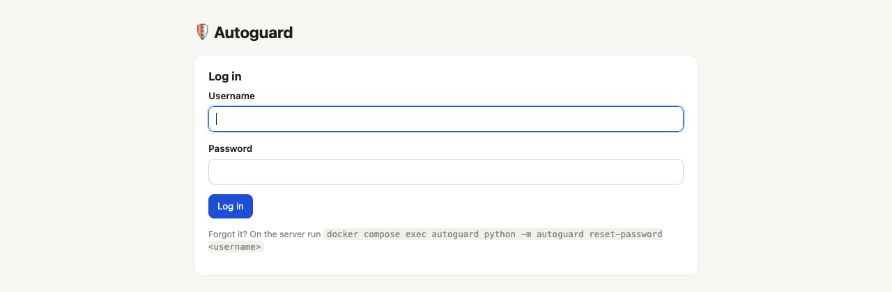

# 6. Looking after it

[← Settings](05-settings.md) · [Guide contents](README.md)

All commands below are run in the `autoguard` folder on the computer where it's installed.

## Logging in



You stay logged in for 30 days per browser. After five wrong passwords in a row, logins with that name are paused
for 15 minutes on that device.

**Forgot your password?** Reset it on the server:

```bash
docker compose exec autoguard python -m autoguard reset-password <username>
```

It asks for the new password twice. Add a person from the terminal the same way with `create-user <username>`.

## Updating

```bash
git pull
docker compose up -d --build
```

Your settings, keys, people and history are kept; the database upgrades itself. (Downloaded the ZIP instead? Download
the new ZIP, unpack it over the old folder, then run the second command.)

## Backing up

Everything Autoguard knows lives in one database file inside the Docker volume `autoguard-data`, including your
keys. To make a copy (safe to run while Autoguard is working):

```bash
docker compose exec -T autoguard python -m autoguard backup > autoguard-backup.db
```

Keep the backup private; it contains your API keys. To put a backup back:

```bash
docker compose exec -T autoguard python -m autoguard restore < autoguard-backup.db
docker compose restart
```

## Checking it's working

```bash
docker compose ps          # should say "healthy"
docker compose logs -f     # what it's doing right now (Ctrl+C to stop watching)
docker compose exec autoguard python -m autoguard scan     # run a check by hand
```

Log lines start with words like `AUTOGUARD_RUN_END` and `AUTOGUARD_VERDICT`, followed by details.

## Using it away from home

Don't open port 8095 on your router. Safer options:

- A VPN to your home network, such as Tailscale or WireGuard (many routers and NAS systems have one built in).
- A reverse proxy with HTTPS and its own login in front of Autoguard.

Autoguard keeps working while you're away; you only need access to review things.

## Uninstalling

```bash
docker compose down -v
```

The `-v` deletes the volume with your keys and history. Sites Autoguard blocked stay on your NextDNS block lists;
remove them in NextDNS (each profile's Denylist) if you want. Afterwards, revoke the AI key with your provider and,
if you like, create a new NextDNS API key.

## Troubleshooting

| What you see | What to do |
|---|---|
| *NextDNS didn't accept that* | Copy the key again from my.nextdns.io/account → API. It's for the whole account, not one profile. |
| A device shows few or no lookups | That device isn't using its NextDNS profile (Private DNS off, a VPN on, or the profile removed). Fix it on the device and lock the setting. |
| *The last check had a problem: AI problem* | Settings → Connections → AI → **Save & test** shows the provider's message. Usually a wrong key, a model name typo, or no credit left. |
| *The AI service was busy* | Nothing to do. It catches up next time. If it happens every time, check less often or pick another provider. |
| *AI reply was not the JSON we asked for* | Settings → AI → Advanced → set JSON mode to *Prompt only*, or choose a bigger model. |
| A blocked site still opens | Phones remember lookups for a few minutes and apps keep connections open. Switch flight mode on and off, or wait. |
| I allowed a site but it's still blocked | Another NextDNS rule also blocks it (a category, a blocked ending like `.ai`, or a manual entry). The NextDNS Logs page shows the reason. |
| Too many sites in To check | Make the topic descriptions more specific, add "NOT …" examples, or lower *Ask me to review*. |
| Something harmless was blocked | Click **Allow everywhere**. It's remembered and shown to the AI as an example. |
| The page doesn't open | `docker compose ps` should say healthy. Check you're using the right address and port, and that you're on the home network. |
| *This form expired* | You were logged out or the page was open a long time. Reload and try again. |

## Questions

**Does it slow down the internet?** No. Autoguard is never in the path of your children's browsing. It only reads
NextDNS's logs and edits its lists.

**How much does the AI cost?** Each new site is checked once. A family typically produces a few hundred new sites in
the first week and a few dozen a day afterwards, a few cents a day with a small model. A local Ollama model costs
nothing.

**What does the AI see?** Site addresses, their public page titles and descriptions, your topic descriptions and
your "what's fine" note. Never which child, when, IP addresses or page contents.

**Where are my keys?** In the database on your own computer, readable only by the Autoguard container. They're
never shown in full again and never sent anywhere except to NextDNS and your AI provider.

**Can my children see it?** Only if they're on your home network and know your password. Use a strong password and
don't add them under People.

**Can I run it for several families?** One Autoguard per NextDNS account. A second family runs its own copy.

**Will it block YouTube or TikTok?** Not by itself: they're on the never-block list because blocking them by mistake
would break a lot. Use NextDNS Parental Control → Apps (with bedtime if you like) for whole apps.

[← Guide contents](README.md)
